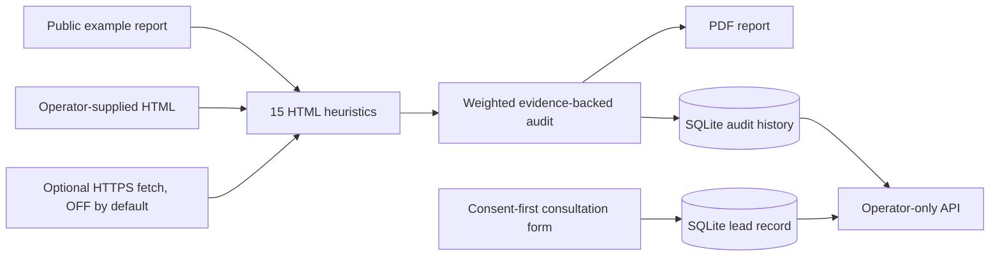

<div align="center">

# ClientMagnet Pro
### Transform website audit findings into actionable fixes and consent-based consultation requests.

**Website diagnostics · Evidence-backed PDF · Lead capture · Developer-focused client demo**

[](#quick-start)
[](#system-overview)
[](https://github.com/rajachanna/ClientMagnet-Pro/actions/workflows/ci.yml)
[](#current-scope)

**[Dashboard preview](docs/assets/dashboard-preview.webp) · [Dashboard source](src/clientmagnet/static/index.html) · [Sample audit report](docs/sample-audit.pdf) · [Offline demo](scripts/demo.py) · [Case study](docs/CASE_STUDY.md) · [Client brief](docs/CLIENT_BRIEF.md) · [NextGen Tech Solutions](https://nextgentechdev.com)**

</div>

---

## Why this project exists

Having ten GitHub projects but few visitors does not automatically lead to paid clients. A public-facing *website health assessment* can give a business owner a reason to engage with a developer: inspect real, visible issues and discuss possible improvements. **ClientMagnet Pro is the technical foundation, not a launched or successful lead-generation campaign.**

This project intentionally starts with secure, inspectable **HTML heuristics**, not invented AI confidence, simulated Google performance metrics or scraped marketing lists.

## Key implemented features

| Feature | Implementation | Boundaries |
| --- | --- | --- |
| Website diagnostics | 15 visible HTML checks across SEO, accessibility and conversion signals | No Google ranking, mobile emulation or audited conversion rate |
| Evidence-backed scores | Transparent weighted diagnostics, top recommendations and issue counts | These are not Google PageSpeed/Lighthouse scores |
| Report export | Branded, multi-page PDF with evidence and limitations | Never implies performance improvements were achieved |
| Synthetic showcase | Public fictional website example + sample PDF with no credentials | Never generated from real customer traffic |
| Operator HTML audits | Private API accepts page URL + supplied HTML; persists report locally | Operator key required; HTML is not kept in database |
| Optional live fetch | HTTPS-only, public DNS/IP allowlisting, pinned TLS socket, bounded HTML | **Disabled by default**; sandbox/network hardening needed before public use |
| Consented leads | Name, email, optional website, request, explicit consent; SQLite records | No CRM forwarding, email delivery or marketing automation |
| Operator analytics | Local number of audits, leads and average diagnostic score | No real-world revenue attribution |
| Quality | Offline tests, CLI demo, wheel/Docker templates and GitHub CI | No production load/security certification |

## System overview



## Quick start

Install **Python 3.11+**. No paid external API, actual website or browser extension required for the basic demo.

```bash
git clone https://github.com/rajachanna/ClientMagnet-Pro.git
cd ClientMagnet-Pro
python -m venv .venv
# Linux/macOS: source .venv/bin/activate
# Windows PowerShell: .venv\Scripts\Activate.ps1
pip install -e ".[dev]"
python scripts/demo.py
python -m pytest -q
```

Set a strong operator secret. For example, in Linux/macOS:

```bash
export CM_OPERATOR_KEY="REPLACE_WITH_YOUR_OWN_32_PLUS_RANDOM_CHAR_SECRET"
uvicorn clientmagnet.api:app --host 127.0.0.1 --port 8000
```

Or use Docker Compose after creating a `.env` file from `.env.example` and replacing the operator key placeholder:

```bash
cp .env.example .env
docker compose up --build
```

**Local dashboard:** http://127.0.0.1:8000/  
**API documentation:** http://127.0.0.1:8000/docs  
**Sample PDF:** http://127.0.0.1:8000/api/demo/pdf

## See the report working

```bash
curl http://127.0.0.1:8000/api/demo
curl -o example-audit.pdf http://127.0.0.1:8000/api/demo/pdf
```

A private, synthetic HTML audit requires the operator key:

```bash
curl -X POST http://127.0.0.1:8000/api/operator/audits \
  -H "Content-Type: application/json" \
  -H "X-Operator-Key: YOUR_OPERATOR_KEY" \
  -d '{"url":"https://demo-business.example.org","html":"<html lang=\"en\"><title>My Local Business Website and Services</title><body><h1>Welcome</h1><a href=\"/contact\">Contact us</a></body></html>"}'
```

The returned JSON contains a random audit ID. Retrieve its private PDF with `GET /api/operator/audits/{id}/pdf` using the same header. The submitted HTML is parsed and discarded; only findings are persisted.

## Working lead consent flow

A visitor may request a consultation by POSTing a name, email, optional URL and `consent=true` to `/api/leads`. Data is stored in local SQLite. Staff can see records only through `/api/operator/leads` with a configured operator key.

**No email is sent; no third-party CRM is connected.** To turn this into a client-acquisition channel, first deploy with a privacy notice, protected database, shared rate limits and abuse protections, then link the URL from your website, LinkedIn and GitHub profile.

## Network security and public scanning

Both `CM_LIVE_FETCH_ENABLED=false` and `CM_PUBLIC_SCANS_ENABLED=false` by default. Only deliberately enable after a separate threat review and cloud egress network restrictions. The optional fetcher validates public standard-port HTTPS domains, checks all DNS results are globally routable, pins the chosen IP for verified TLS, bounds redirects and reads one HTML page.

These safeguards **are not a production-grade SSRF sandbox** and do not confer permission to crawl third-party websites. [Security design and release gates](SECURITY.md).

## Diagnostic scoring vs real performance

SEO checks cover title, description, main heading, canonical, noindex and links. Accessibility checks cover `lang`, viewport, alt, input labels, headings and new-tab links. Conversion checks cover visible CTAs, contact pathways and forms.

**The score is an internal diagnostic rubric.** It does *not* measure Core Web Vitals, LCP, CLS, INP, Google search positions, real conversions or business revenue. Even optional HTTPS fetching only records the fetch duration—not true page loading speed. Do not label the result a Google score.

## Development status

- Implemented: local HTML audit, private PDF export, synthetic report, consent-first leads, secure operator API, Docker recipe and automated tests.
- Implemented but disabled by default: bounded, pinned-IP HTTPS HTML fetch, with deployment review required.
- Not implemented: production hosting, Lighthouse/PageSpeed integration, browser screenshots, Search Console, GA4, outreach email/SMS delivery, HubSpot sync, analytics attribution, customer conversion results and autonomous AI recommendations.

**[Roadmap](ROADMAP.md) · [Engineering case study](docs/CASE_STUDY.md) · [Client discovery template](docs/CLIENT_BRIEF.md)**

## Business and developer

**Raja Channa — NextGen Tech Solutions**  
AI automation, Python/FastAPI, sales workflow engineering, trading APIs, ecommerce systems and website development.

For authorized audit implementation and custom integrations: https://nextgentechdev.com

**MIT license.** This repo uses a fictional business in its demo. No client traffic or guaranteed outcomes are represented.
